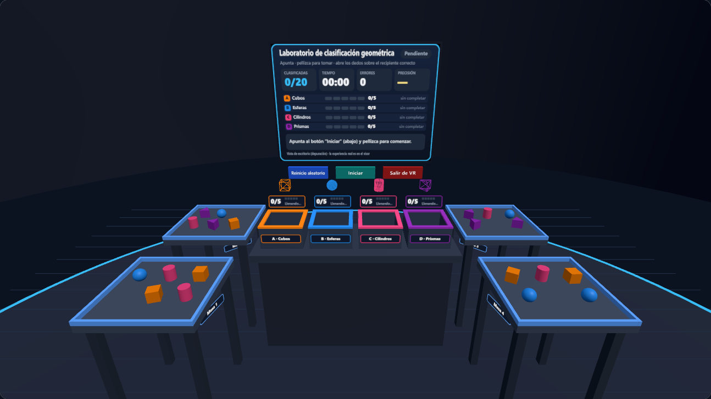

# Laboratorio inmersivo de clasificación geométrica

Aplicación web de **realidad virtual inmersiva** para **Meta Quest 3** con **física real**. Veinte figuras geométricas de cuatro clases están repartidas al azar sobre cuatro mesas. Con **seguimiento de manos** y **gesto de pinza**, el usuario las toma y las clasifica en cuatro recipientes 3D abiertos. Gravedad, rebotes, fricción y colisiones las calcula un motor de física; no son animaciones.

- **Materia:** Desarrollo de Ambientes Virtuales — 3.2 Interacción virtual (amplía la práctica 3.1)
- **Autora:** Melissa Manzano
- **Tecnologías:** HTML5, CSS3, Bootstrap 5.3.3, JavaScript (módulos ES), Three.js r170, WebXR Device API, **cannon-es 0.20.0**
- **Sitio publicado:** https://melissamanzano.github.io/interaccion-vr-lab/
- **Repositorio:** https://github.com/melissaManzano/interaccion-vr-lab
- **Video de demostración:** *(agregar enlace)*

> Este repositorio amplía la práctica 3.1 ([laboratorio-vr-ensamblaje](https://github.com/melissaManzano/laboratorio-vr-ensamblaje)). Su último commit está marcado con la etiqueta `practica-3.1`.



---

## 1. Requisitos

| Para | Necesitas |
|---|---|
| Desarrollar | Visual Studio Code, la extensión **Live Server** y Git |
| Publicar | Una cuenta de GitHub (repositorio público) |
| Probar en VR | Meta Quest 3, **Meta Quest Browser** actualizado y el **seguimiento de manos activado** (*Configuración → Movimiento → Seguimiento de manos*) |

**No se usan** Node.js (salvo para las pruebas opcionales), npm, bundlers, backend ni base de datos. Todo son archivos estáticos y bibliotecas por CDN.

## 2. Ejecutar en local (Live Server)

1. Abre la carpeta del proyecto en VS Code.
2. Haz clic derecho en `index.html` y elige **Open with Live Server** (o pulsa **Go Live**).
3. Se abre `http://127.0.0.1:5500/`.

> No abras `index.html` con doble clic (`file://`): los módulos ES y el import map fallan por CORS.

En la PC el botón muestra **"VR no disponible aquí"**, y es lo normal. La **Vista previa de depuración** usa la misma escena y la misma física con el mouse:

| Acción | Control |
|---|---|
| Comenzar la ronda | **Clic** en el botón 3D *Iniciar* |
| Tomar una figura | Mantener **clic izquierdo** sobre ella |
| Soltarla | Soltar el botón: cae con gravedad |
| Alejar o acercar la figura sostenida | **Rueda** mientras la sostienes |
| Girar la cámara | **Clic derecho** y arrastrar |
| Acercar o alejar la cámara | **Rueda** sin sostener nada |

> ⚠️ El `localhost` de la PC **no es** el `localhost` del visor. Las pruebas con manos se hacen en el Quest **con la URL HTTPS de GitHub Pages**.

## 3. Publicar en GitHub Pages

```bash
git add .
git commit -m "Práctica 3.2: clasificación con física"
git push
```

1. En GitHub, ve a **Settings → Pages**.
2. En **Source** elige **Deploy from a branch**, **Branch: `main`**, carpeta **`/ (root)`** y pulsa **Save**.
3. Espera uno o dos minutos y abre `https://<usuario>.github.io/interaccion-vr-lab/`.
4. En el Quest, abre esa URL en Meta Quest Browser y pulsa **Entrar a VR**.

El archivo `.nojekyll` evita que GitHub Pages procese el sitio con Jekyll.

**Rutas.** Todas las rutas internas son **relativas** (`css/styles.css`, `js/main.js`), porque el sitio vive bajo `/interaccion-vr-lab/`. Una ruta que empiece con `/` daría **404**. GitHub Pages **distingue mayúsculas de minúsculas** y Windows no, así que hay que respetarlas en los `import`.

## 4. Controles en VR

| Acción | Gesto |
|---|---|
| Comenzar | Apunta al botón 3D **Iniciar** y cierra la pinza |
| Apuntar | Cada mano proyecta un rayo desde el punto entre el pulgar y el índice |
| Tomar de cerca | Cierra la pinza **junto a** una figura (a menos de 7 cm) |
| Tomar a distancia | Apunta con el rayo y cierra la pinza |
| Alejar o acercar | Con agarre a distancia, **estira o recoge el brazo** |
| Soltar o lanzar | Abre los dedos: la figura vuelve a ser dinámica y conserva la velocidad de tu mano |
| Reinicio aleatorio o salir | Apunta al botón 3D y cierra la pinza |

Colores del rayo: **blanco** sin objetivo, **celeste** sobre una figura, **amarillo** sobre un botón y **verde** mientras sostienes.

> La pinza con la **palma hacia ti** es el gesto del sistema Meta (abre el menú). La app la ignora.

## 5. El laboratorio

**Escena:**

- **4 mesas** con borde bajo: a la izquierda y a la derecha, cerca y lejos.
- **1 mostrador central** con **4 recipientes abiertos** (27 × 27 × 14 cm).
- **Marcador 3D** encima del mostrador, con los botones *Reinicio aleatorio*, *Iniciar* (solo antes de comenzar) y *Salir de VR*.
- El esquema con medidas, alturas y recorridos seguros de las manos está en [docs/esquema-laboratorio.svg](docs/esquema-laboratorio.svg).

**Clases** (5 figuras de cada una, 20 en total):

| Clase | Figura | Color | Recipiente | Colisionador |
|---|---|---|---|---|
| A | Cubo (6 cm) | Naranja | R1 · A · Cubos | `Box` |
| B | Esfera (Ø 6.8 cm) | Azul | R2 · B · Esferas | `Sphere` |
| C | Cilindro (Ø 6 × 7 cm) | Rosa | R3 · C · Cilindros | `Cylinder` de 16 lados |
| D | Prisma triangular | Morado | R4 · D · Prismas | `Cylinder` de 3 lados (convexo exacto) |

Cada clase se reconoce por **forma, color y letra**. Cada recipiente lleva además su nombre y una **silueta flotante** de la figura que le corresponde. El rojo y el verde se reservan para error y acierto.

### Estados de cada figura

| Estado | Cuándo | Señal visual |
|---|---|---|
| Disponible | En reposo sobre una mesa | — |
| Sujeta | En tu mano: el cuerpo pasa a **cinemático** | Azul |
| En caída | Suelta y moviéndose: el cuerpo vuelve a **dinámico** | — |
| En validación | Dentro de un recipiente, esperando estabilizarse | — |
| Clasificada | Aceptada; ya no se puede tomar | Verde |
| Recuperable | En reposo en el suelo; recógela con el rayo | Ámbar pulsante |

El marcador indica cuántas figuras están en caída, en validación o recuperables.

### Reglas

La ronda empieza al pulsar **Iniciar**: antes no se puede tomar nada y el cronómetro está en 00:00.

**Soltar no valida.** La figura cae y la validación ocurre cuando **queda en reposo dentro** de un recipiente (350 ms casi quieta):

| Resultado | Efecto |
|---|---|
| ✅ Recipiente correcto | +1 total (X/20) y +1 en su recipiente (X/5), destello verde, sonido, figura bloqueada |
| ❌ Recipiente equivocado | +1 error, destello rojo, mensaje con el recipiente correcto y **el recipiente la expulsa con un impulso físico** |
| 🏁 Recipiente 5/5 | Se registra su **tiempo de llenado** y su borde se pone verde |
| 🏆 20/20 | Se detiene el cronómetro y aparece el resumen final |

**Indicadores:**

| Indicador | Qué muestra |
|---|---|
| Clasificadas | De 0/20 a 20/20 |
| Por recipiente | De 0/5 a 5/5, en el marcador y en una pantalla detrás de cada recipiente |
| Errores | Una vez por intento. Si una figura equivocada recae en el mismo recipiente, se expulsa otra vez sin contar otro error |
| Precisión | Aciertos ÷ (aciertos + errores). Muestra "—" antes del primer intento |
| Tiempo global | Arranca con *Iniciar*, se pausa fuera de VR y se detiene en 20/20 |
| Tiempo de llenado | Tiempo desde *Iniciar* hasta que cada recipiente llega a 5/5 |

**Reinicio aleatorio.** Vuelve a repartir las 20 figuras entre las mesas, en posiciones y giros nuevos, pone en cero todo lo anterior y regresa a *Pendiente* (botón *Iniciar*).

**Recuperación segura:**

- Las figuras que caen al suelo quedan *recuperables* y se recogen con el rayo.
- Si una figura sale de la sala, vuelve a su mesa.
- Si se pierde el seguimiento de la mano o termina la sesión VR, la figura sujeta se suelta y cae.

Todo se ajusta en [js/config.js](js/config.js) sin tocar la lógica: medidas, masas, fricción, rebote, umbrales de reposo, fuerza de expulsión, etc.

## 6. Arquitectura

```
index.html                Portada Bootstrap + import map (three, three/addons, cannon-es)
css/styles.css            Estilos de la portada
js/
├── main.js               Conecta las capas y ejecuta el ciclo de cada cuadro
├── config.js             Clases, mesas, recipientes, física y reglas (un solo lugar)
├── bootGuard.js          Muestra un error útil si el CDN o los módulos fallan
├── core/state.js         Estado único: figuras, recipientes, aciertos, errores, fase, cronómetro
├── scene/                RENDERIZADO
│   ├── sceneSetup.js       Renderer, cámara, luces, sala
│   └── labBuilder.js       Mesas con borde, mostrador, recipientes abiertos y su apariencia
├── physics/              FÍSICA (cannon-es)
│   ├── physicsWorld.js     Mundo, gravedad, materiales, colisionadores estáticos, paso fijo
│   ├── colliders.js        Malla + colisionador de cada figura con las mismas medidas
│   └── holdController.js   Agarre: dinámico → cinemático (por velocidad + barrido) → dinámico
├── objects/              GENERACIÓN
│   ├── objectFactory.js    Crea las 20 figuras (malla + cuerpo rígido) y sincroniza
│   └── layoutGenerator.js  Reparto aleatorio sobre las mesas (puro, con semilla opcional)
├── interaction/          INTERACCIÓN
│   ├── selectables.js      Seleccionables con prioridad (botón > figura) y búsqueda cercana
│   ├── dragController.js   Objetivo del agarre: cercano o rayo + "carrete"
│   └── interactionManager.js  Manos/mouse → agarrar, sostener, soltar, botones
├── validation/           VALIDACIÓN
│   ├── sortingRules.js     Reglas puras: dentro del recipiente, acierto/error, precisión
│   └── sortingMonitor.js   Observa la física: estados, depósito, expulsión y recuperación
├── logic/
│   ├── gameMachine.js      Máquina de estados: agarres, depósitos, llenado, fin, reinicio
│   └── timer.js            Cronómetro con pausa
├── ui/                   MARCADOR
│   ├── scoreboard.js       Marcador 3D: X/20, tiempo, errores, precisión, 0/5 y llenado por recipiente
│   ├── binDisplays.js      Pantalla 0/5 detrás de cada recipiente
│   ├── vrButtons.js        Botones 3D
│   ├── canvasText.js       Texto en canvas
│   └── landingUI.js        Portada: compatibilidad, clases, resumen
├── xr/                   Sin cambios desde 3.1: sesión, manos, pinza con histéresis
├── audio/soundFx.js      Sonidos sintetizados (incluye golpes según la velocidad de impacto)
└── debug/desktopPreview.js  Vista previa con mouse (escritorio)
tests/logic.test.mjs      33 pruebas de reglas de negocio con Node
docs/                     Diseño WebXR (3.1), física/clasificación y diseño de la actividad (3.2), esquema y capturas
```

El razonamiento completo está en [docs/04-fisica-y-clasificacion.md](docs/04-fisica-y-clasificacion.md):

- elección y versiones de cannon-es;
- import map;
- tabla de colisionadores;
- control por velocidad;
- validación;
- accesibilidad;
- verificación realizada;
- licencias.

El diseño de la actividad está en [docs/05-diseno-de-la-actividad.md](docs/05-diseno-de-la-actividad.md):

- módulos reutilizados de la 3.1 y referencia `webxr_vr_handinput_pointerdrag`;
- respaldo de la 3.1;
- categorías y reglas;
- esquema de mesas y alturas;
- conceptos de física (malla, cuerpo y colisionador; paso fijo);
- capturas;
- qué se prueba en escritorio y qué en el visor.

Los fundamentos de WebXR y del seguimiento de manos siguen en [docs/02-webxr-y-arquitectura.md](docs/02-webxr-y-arquitectura.md).

**Decisiones principales:**

- **La física manda.** La malla solo copia la pose interpolada del cuerpo rígido. No hay *snap* ni animaciones que simulen caídas.
- **Dinámico → cinemático → dinámico.** Al sujetarla, la figura pasa a cinemática y sigue a la mano por velocidad (sin teletransportes). Un barrido con rayo evita que atraviese mesas y paredes, y empuja a las demás figuras. Al soltarla vuelve a dinámica con una velocidad de liberación promediada y limitada.
- **Validar en reposo, no al soltar.** Un rebote que saca la figura no cuenta, y un lanzamiento que entra sí cuenta.
- **Reglas puras.** Lo que decide aciertos, errores, precisión y distribución no depende de Three.js ni de cannon-es, y se prueba con Node.
- **Un solo estado.** Los totales se calculan desde el estado; el marcador, las pantallas y la portada solo leen.

## 7. Rendimiento y estabilidad

- **Física:**
  - paso fijo de 1/90 s (máximo 4 subpasos por cuadro), con interpolación para dibujar sin tirones;
  - broadphase SAP y cuerpos que se duermen en reposo;
  - 20 cuerpos dinámicos y 10 estáticos.
- **Estabilidad:**
  - formas primitivas o convexas (sin Trimesh);
  - paredes de 2 cm;
  - velocidad máxima al sostener (5 m/s) y al soltar (3.5 m/s);
  - figuras creadas sin encimarse;
  - recuperación de las que escapan.
- **Render:**
  - sin sombras dinámicas ni posprocesado, con dos luces;
  - una geometría por clase;
  - los canvas solo se redibujan cuando cambia el texto.
- **Memoria:** el ciclo reutiliza vectores. Al salir de la página se liberan cuerpos, geometrías, materiales y texturas.

**Cómo verificar en el visor:** depuración remota con el Quest por USB (modo desarrollador) en `chrome://inspect`, y *OVR Metrics Tool* para los FPS.

> No se reportan FPS porque no se han medido en el dispositivo.

## 8. Matriz de pruebas de aceptación

| # | Requisito | Cómo probar | Resultado esperado | Resultado observado | Evidencia |
|---|---|---|---|---|---|
| 1 | Portada, compatibilidad (incluye cannon-es) | Escritorio y modo dispositivo | Todo visible, checks correctos | ✅ Escritorio (Chrome headless) | |
| 2 | Sin errores; import map con versiones fijadas | Console y Network | 0 errores; three 0.170.0 y cannon-es 0.20.0 en 200 | ✅ Local (0 errores y 0 advertencias) | |
| 3 | Despliegue en Pages (HTTPS) | Abrir https://melissamanzano.github.io/interaccion-vr-lab/ | Igual que en local | | |
| 4 | Sesión VR real y salida | Quest → Entrar a VR → Salir | Fondo virtual, vuelve a la portada | | |
| 5 | Manos izquierda y derecha | Marcador "Izquierda ✓ Derecha ✓" | Ambas detectadas | | |
| 6 | 4 mesas, 20 figuras (4 × 5) al azar | Observación y reinicio | 5 por mesa, clases mezcladas | ✅ Escritorio | [01](docs/capturas/01-mesas-y-20-figuras.png) |
| 7 | Gravedad y reposo | Al cargar | Las figuras caen y se asientan | ✅ Escritorio | [01](docs/capturas/01-mesas-y-20-figuras.png) |
| 8 | Pinza cercana y a distancia; cinemático al sujetar, dinámico al soltar | Con cada mano | La figura sigue a la mano sin atravesar la mesa | Mouse ✅ (tipo 4 → 1) / Quest pendiente | [02](docs/capturas/02-agarre-cinematico.png) |
| 9 | Colisiones con mesa, suelo, recipiente y otras figuras | Empujar, soltar sobre el borde, apilar | No atraviesa nada; rebota y rueda | ✅ Escritorio | [05](docs/capturas/05-colisiones-caida.png), [06](docs/capturas/06-colisiones-reposo-y-recuperable.png) |
| 10 | Acierto | Figura en su recipiente | Verde, sonido, +1, X/5 | ✅ Escritorio | [03](docs/capturas/03-acierto.png) |
| 11 | Error y expulsión | Figura en otro recipiente | Rojo, +1 error, sale del recipiente | ✅ Escritorio | [04](docs/capturas/04-error-y-expulsion.png) |
| 12 | Precisión y tiempos de llenado | Llenar los recipientes | 5/5 con tiempo; precisión correcta | ✅ Escritorio | [08](docs/capturas/08-marcador-final.png) |
| 13 | Inicio, 20/20 y fin | *Iniciar* y completar todo | Cronómetro detenido, mensaje final | ✅ Escritorio | [07](docs/capturas/07-vista-final.png), [08](docs/capturas/08-marcador-final.png) |
| 14 | Reinicio aleatorio | Botón 3D | 0/20, *Pendiente*, nueva distribución | ✅ Escritorio | |
| 15 | Salir y reentrar | Botón y menú del sistema | Progreso conservado; figuras en mano caen | | |
| 16 | Rendimiento y comodidad en el visor | OVR Metrics, uso de 5 min | Fluido y sin mareo | | |

**Pruebas automatizadas:** `node --test tests/logic.test.mjs` (Node 18+, sin npm) da **33/33**.

**Se debe validar físicamente en el Quest:** las pruebas 3 a 5, 8, 15 y 16, la sensibilidad de la pinza y la sensación del "carrete".

## 9. Limitaciones conocidas

- cannon-es no tiene detección continua de colisiones (CCD). Un lanzamiento muy rápido podría atravesar una pared delgada. Se mitiga limitando la velocidad al soltar y recuperando las figuras que escapan.
- Las manos no tienen colisionador propio: empujan figuras solo a través de la figura que sostienen.
- El barrido del agarre cinemático usa un rayo desde el centro de la figura. Si su borde roza una esquina, puede entrar unos milímetros; al soltarla, el solver la separa.
- La vista previa de escritorio no simula manos; sirve para probar la física y la lógica.
- Si el CDN de WebXR Input Profiles no responde, no aparecen las mallas de las manos (los rayos sí). Solución: `hands.modelProfile: 'spheres'` en `config.js`.

## 10. Créditos y licencias

- **Código del proyecto:** © 2026 Melissa Manzano, licencia MIT (ver `LICENSE`).
- **[Three.js](https://threejs.org/) r170:** MIT.
- **[cannon-es](https://github.com/pmndrs/cannon-es) 0.20.0:** MIT.
- **[Bootstrap](https://getbootstrap.com/) 5.3.3:** MIT.
- **Modelos de manos:** [WebXR Input Profiles](https://github.com/immersive-web/webxr-input-profiles), MIT.
- **Figuras, mesas y recipientes:** geometría generada en código (sin modelos de terceros).
- **Sonidos:** sintetizados con Web Audio API (sin archivos de terceros).
- **Desarrollo:** asistido por un agente de IA (Claude) bajo la supervisión de la autora.
