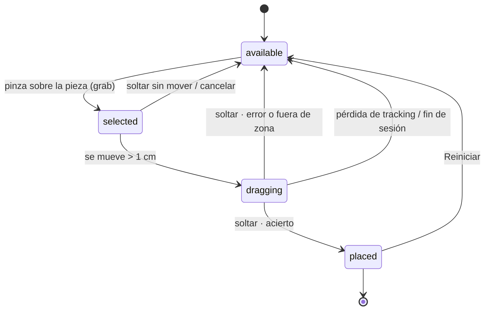
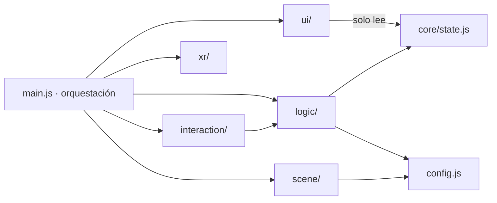
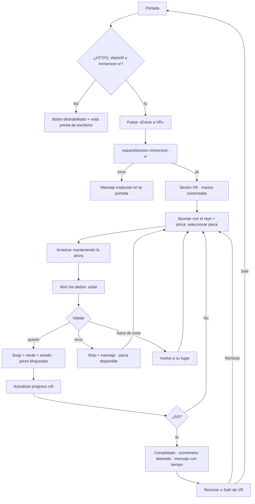

# 2. Comprender WebXR y diseñar la arquitectura

Documento de diseño del *Laboratorio virtual de manipulación y ensamblaje 3D*. Explica los conceptos de WebXR que usa la aplicación, cómo funciona el seguimiento de manos, cómo se organiza el código y cómo se comprueba que el proyecto (generado con apoyo de IA) cumple los requisitos.

Las referencias a archivos apuntan al código real del proyecto.

---

## 5. VR, vista 3D y sesión WebXR

### 5.1 VR no es lo mismo que una vista 3D

| | Vista 3D en escritorio | Realidad virtual (sesión `immersive-vr`) |
|---|---|---|
| Imagen | Una sola imagen plana en un monitor | **Estereoscópica**: una imagen distinta para cada ojo, con profundidad real |
| Cámara | La mueve el mouse o el teclado | La mueve **la cabeza del usuario** (seguimiento de 6 grados de libertad) |
| Escala | Arbitraria | **1 unidad = 1 metro real**. La mesa mide 80 cm de alto porque así se percibe |
| Entrada | Mouse, teclado | Manos rastreadas (o mandos) |
| Campo de visión | Ventana del navegador | Todo el entorno; el fondo es **opaco y virtual** |

Una escena de Three.js en la PC **no es VR**, aunque sea 3D. En este proyecto, la **vista previa de depuración** del escritorio ([desktopPreview.js](../js/debug/desktopPreview.js)) usa la misma escena, pero solo sirve para probar la lógica con el mouse. La experiencia VR existe únicamente cuando el visor abre una sesión `immersive-vr`.

Por eso todas las medidas de [config.js](../js/config.js) están en metros y el origen es el piso donde está el usuario.

### 5.2 Qué hace la WebXR Device API

WebXR es la API del navegador que conecta la página con el visor. Se encarga de:

1. **Abrir la sesión.** `navigator.xr.requestSession('immersive-vr', opciones)` pide al visor entrar en modo inmersivo. Solo funciona en **HTTPS** (o `localhost`) y **tras un gesto del usuario** (un clic).
2. **Dar el sistema de seguimiento.** El *espacio de referencia* (`local-floor`) define dónde está el origen: el piso, bajo los pies del usuario. A partir de ahí, la API entrega cada frame la pose de la cabeza y de las manos.
3. **Entregar las fuentes de entrada.** Cada mano o mando es un `XRInputSource`.
4. **Marcar el ritmo de render.** El visor decide cuándo dibujar cada frame (72–120 Hz en Quest 3), no `requestAnimationFrame` de la ventana.
5. **Terminar la sesión.** Con `session.end()` o desde el menú del sistema; en ambos casos se dispara el evento `end`.

En el proyecto:

- La sesión se pide en [xrSession.js](../js/xr/xrSession.js) con `optionalFeatures: ['local-floor', 'bounded-floor', 'hand-tracking']`.
- `hand-tracking` es **opcional a propósito**. Si fuera obligatorio y el usuario lo tuviera desactivado, la sesión no abriría y no se le podría avisar. Así, la sesión abre y el HUD muestra "activa el seguimiento de manos" ([main.js](../js/main.js), en `onStart`).
- **No se usa** `immersive-ar`, *passthrough* ni las cámaras del visor.

### 5.3 Detección de capacidades, no de user-agent

La compatibilidad se comprueba **preguntándole al navegador lo que sabe hacer**, no adivinando por su nombre:

```js
const secure    = window.isSecureContext;                          // ¿HTTPS o localhost?
const hasWebXR  = 'xr' in navigator;                               // ¿Existe la API?
const vrOk      = await navigator.xr.isSessionSupported('immersive-vr'); // ¿Hay un visor capaz?
```

**Por qué no el user-agent:** la cadena `navigator.userAgent` se puede falsificar, cambia con cada versión y no dice si hay un visor conectado ni si el permiso está concedido. Un Chrome de escritorio con un visor conectado por cable *sí* puede hacer VR; un Quest con WebXR desactivado *no*. Solo `isSessionSupported` responde la pregunta real.

En el proyecto ([xrSession.js](../js/xr/xrSession.js), `detectXrSupport`):

- La consulta tiene un **límite de 5 s**, porque algunos navegadores nunca responden.
- Los resultados se muestran en la portada como una lista de comprobación (contexto seguro, WebXR, `immersive-vr`, manos).
- Si no hay soporte, el botón dice **"VR no disponible aquí"** y queda deshabilitado, en lugar de fallar al pulsarlo.
- El seguimiento de manos **no se puede detectar antes** de entrar: se confirma dentro de la sesión con `session.enabledFeatures` y con los eventos `connected` de cada mano.

### 5.4 El papel de VRButton y del ciclo de animación de Three.js

**VRButton** (`three/addons/webxr/VRButton.js`) es un ayudante de Three.js que:

1. crea un botón HTML;
2. llama a `isSessionSupported('immersive-vr')` y cambia el texto a "ENTER VR" o "VR NOT SUPPORTED";
3. al pulsarlo, llama a `requestSession(...)` y luego a `renderer.xr.setSession(session)`;
4. escucha el evento `end` para volver a mostrar "ENTER VR".

**Este proyecto no usa VRButton**, sino un controlador propio ([xrSession.js](../js/xr/xrSession.js)) que hace los mismos cuatro pasos. Motivos:

- El botón debe integrarse en la portada Bootstrap, en español y con estados ("Cargando…", "Iniciando…", "En VR…").
- Hay que **traducir los errores** (`NotSupportedError`, `SecurityError`, `NotAllowedError`…) a mensajes comprensibles (`describeXrError`).
- Hay que reaccionar al inicio y al fin de la sesión: pausar el cronómetro, cancelar arrastres, limpiar las manos y restaurar la portada.
- Evita **dobles clics**: la bandera `starting` impide abrir dos sesiones.

**El ciclo de animación.** Three.js no usa `requestAnimationFrame` directamente, sino:

```js
renderer.xr.enabled = true;                    // sceneSetup.js
renderer.xr.setReferenceSpaceType('local-floor');
renderer.setAnimationLoop(onFrame);            // main.js
```

`setAnimationLoop` es la pieza clave. **Fuera de VR** llama a `onFrame` con el `requestAnimationFrame` de la ventana; **dentro de VR** cambia automáticamente al `requestAnimationFrame` **de la sesión XR**, que es el único que entrega las poses de cabeza y manos y el ritmo del visor. Con un `requestAnimationFrame` de ventana, la escena no se dibujaría en el visor.

Cada frame, `onFrame` en [main.js](../js/main.js) sigue este orden:

```
leer fuentes (manos o mouse) → procesar eventos de pinza → hover y arrastre
→ actualizar apariencia → actualizar panel → renderer.render()
```

Durante VR, Three.js dibuja la escena **dos veces por frame**, una por ojo, con la cámara estereoscópica que construye a partir de la pose de la cabeza.

---

## 6. Seguimiento de manos

### 6.1 Poses de articulaciones y XRInputSource

Con la función `hand-tracking` activa, cada mano aparece como un `XRInputSource` que tiene:

| Propiedad | Qué contiene | Cómo se usa aquí |
|---|---|---|
| `handedness` | `'left'` o `'right'` | Identificar la mano (HUD "Izquierda ✓ Derecha ✓") |
| `hand` | Un `XRHand` con **25 articulaciones** (muñeca, falanges de cada dedo, puntas) | Pinza y orientación de la palma |
| `targetRaySpace` | La pose del **rayo de apuntado** que calcula el sistema | Dirección del rayo |
| `gripSpace` | Pose para "sostener" objetos | No se usa |

Cada articulación tiene posición, orientación y radio. Three.js las expone como `renderer.xr.getHand(i).joints['index-finger-tip']`, etc. Si una articulación no se ve en ese frame, su propiedad `visible` es `false`.

En [hands.js](../js/xr/hands.js):

- Se crean dos manos (`getHand(0)` y `getHand(1)`) con su modelo visible (`XRHandModelFactory`).
- Si se conecta una fuente **sin** `hand` (un mando físico), se ignora y se avisa: la práctica es solo con manos.
- La pérdida de tracking se tolera unos **10 frames**. Si la mano no vuelve, la pieza que sostenía se libera **sin validar**.

### 6.2 Rayo de apuntado y raycasting

Son dos cosas distintas que trabajan juntas:

- **Rayo de apuntado (el "qué apunto").** Es una semirrecta con origen y dirección. Aquí el **origen** es el punto medio entre la punta del índice y la del pulgar, y la **dirección** es la del `targetRaySpace` que entrega el sistema (estable y coherente con el resto de apps del Quest).
- **Raycasting (el "qué toca").** Es el cálculo geométrico que encuentra los objetos 3D que cruza esa semirrecta y a qué distancia. Lo hace `THREE.Raycaster`.

Decisiones del proyecto ([selectables.js](../js/interaction/selectables.js)):

- El rayo solo prueba una **lista cerrada** de objetos registrados (botones y piezas). El piso, la mesa, las siluetas y el panel nunca se seleccionan por error.
- **Prioridad:** primero botones, luego piezas. Una pinza sobre un botón nunca agarra a la vez una pieza que esté detrás.
- Las piezas ya colocadas se excluyen del raycast (`isEnabled → game.canGrab`).
- El rayo cambia de color como retroalimentación: blanco (nada), celeste (pieza), amarillo (botón), verde (arrastrando).

### 6.3 Pinza de selección y pinza del sistema

**Pinza habitual (seleccionar y soltar).** Se calcula con la distancia entre `index-finger-tip` y `thumb-tip`, con **histéresis** ([pinchDetector.js](../js/xr/pinchDetector.js)):

```
distancia < 2 cm   → se CIERRA la pinza  (seleccionar)
distancia > 3.5 cm → se ABRE la pinza    (soltar)
entre 2 y 3.5 cm   → se mantiene el estado anterior
```

Con un único umbral, el ruido del tracking haría que el estado alternara varias veces por segundo cerca del límite y la pieza se soltaría sola. La zona intermedia lo evita.

> No se depende de los eventos `selectstart`/`selectend` del navegador. Se registran en consola solo como diagnóstico.

**Pinza con la palma hacia el usuario (menú del sistema).** En Meta Quest, ese gesto abre el menú del visor. La aplicación **lo ignora** para no iniciar acciones a la vez:

- Se toma el eje −Y de la muñeca (apunta hacia el lado de la palma) y la dirección de la muñeca a la cabeza.
- Si su producto punto es mayor que `palmFacingDot` (0.6), la palma mira al usuario y **no se inicia** la pinza.
- Si la palma gira **durante** un agarre ya iniciado, la pieza **no** se suelta. Solo se bloquea el *inicio*.

### 6.4 Selección, arrastre, liberación y confirmación

| Estado / evento | Disparador | Qué pasa | Estado de la pieza en el store |
|---|---|---|---|
| **Apuntar (hover)** | El rayo toca una pieza disponible | La pieza se ilumina; el rayo se vuelve celeste | `available` |
| **Selección** | La pinza se cierra sobre la pieza | `game.grab()` comprueba que se pueda tomar, inicia el cronómetro, guarda qué mano la sostiene | `selected` (con `heldBy`) |
| **Arrastre** | La mano se mueve más de 1 cm con la pinza cerrada | La pieza sigue el rayo con su *offset* de agarre, suavizado y dentro de los límites de la mesa | `dragging` |
| **Liberación** | La pinza se abre | Termina el arrastre y se **valida** la posición (solo aquí) | pasa a validación |
| **Confirmación (acierto)** | Destino correcto y ≤ 8 cm | Snap a la posición exacta, verde, sonido, contador +1 | `placed` (bloqueada) |
| **Rechazo** | Destino incorrecto o distancia excesiva | Destello rojo, sonido grave, mensaje explicativo; no suma | `available` |
| **Fuera de zona** | No hay destino a menos de 20 cm | La pieza regresa a su lugar | `available` |
| **Cancelación** | Pérdida de tracking o fin de sesión | Se libera **sin validar** y vuelve a su lugar | `available` |



Una pieza en `placed` **no** puede volver a tomarse. Solo el botón **Reiniciar** la devuelve a `available`.

---

## 7. Arquitectura y flujo de interacción

### 7.1 Responsabilidades y por qué separarlas

La aplicación tiene estas responsabilidades funcionales:

| Responsabilidad | Pregunta que responde | Dónde vive hoy |
|---|---|---|
| **Configuración** | ¿Cuánto mide todo y cuánta tolerancia hay? | `config.js` |
| **Estado** | ¿En qué situación está cada pieza y el reto? | `core/state.js` |
| **Reglas de negocio** | ¿Esta pieza soltada aquí es acierto o error? | `logic/assemblyRules.js` |
| **Flujo del reto** | ¿Qué fase sigue y qué se notifica? | `logic/gameMachine.js`, `logic/timer.js` |
| **Escena** | ¿Qué se dibuja y cómo se ve? | `scene/` |
| **Sesión XR** | ¿Hay soporte? ¿Cómo se entra y se sale? | `xr/xrSession.js` |
| **Entrada (manos)** | ¿Dónde apunta cada mano y si pellizca? | `xr/hands.js`, `xr/pinchDetector.js` |
| **Interacción** | ¿Qué toca el rayo y qué pieza se arrastra? | `interaction/` |
| **Interfaz** | ¿Qué ve el usuario dentro y fuera de VR? | `ui/` |
| **Retroalimentación sonora** | ¿Qué suena en cada evento? | `audio/soundFx.js` |
| **Orquestación** | ¿Quién conecta todo y en qué orden por frame? | `main.js` |

Los nombres y carpetas son una decisión de este proyecto; lo importante es la separación. Conviene separar porque:

1. **Se puede probar sin visor.** Las reglas, el estado, el cronómetro y la pinza no dependen de Three.js ni del DOM, así que se prueban en segundos con Node (ver 7.4). Si la validación estuviera mezclada con el raycast, solo se podría probar con el Quest puesto.
2. **Un cambio no rompe lo demás.** Ajustar la tolerancia es editar un número en `config.js`; cambiar el aspecto del panel no toca las reglas.
3. **Una sola implementación de la interacción.** Manos y mouse producen "fuentes de puntero" con la misma forma (`{ id, active, ray, event }`). La lógica de hover, arrastre y validación se escribe una vez.
4. **Errores localizados.** Si falla el seguimiento, el problema está en `xr/`; si el contador es incorrecto, en `logic/` o `core/`.
5. **Revisión del código generado por IA.** Con módulos pequeños y de propósito claro, se puede leer y verificar cada parte por separado.

Dependencias permitidas (las flechas indican "usa a"):



`logic/` y `core/` **no** importan Three.js, la escena ni la interfaz: los efectos visuales y sonoros les llegan como *hooks* (`onSuccess`, `onError`, `onReturnHome`…).

### 7.2 Flujo completo



Fases del reto ([gameMachine.js](../js/logic/gameMachine.js)): **Pendiente** → (primer agarre) → **Activo** → (5/5) → **Completado**. Reiniciar vuelve a Pendiente desde cualquier fase.

### 7.3 Un único estado, sin acciones duplicadas, y reglas documentadas

**Un único estado de progreso.** [state.js](../js/core/state.js) guarda la fase, el estado de cada pieza, quién la sostiene, el cronómetro, la sesión XR y el mensaje actual. El resto de módulos **leen** con `getState()` y **modifican** solo con métodos del store.

El contador **no se guarda**: `placedCount()` cuenta las piezas en `placed`. Así no puede quedar desincronizado ni sumarse dos veces. El HUD 3D y la portada leen el mismo valor.

**Protecciones contra acciones duplicadas:**

| Riesgo | Protección | Dónde |
|---|---|---|
| Dos manos toman la misma pieza | `canGrab` exige `available` y `heldBy === null` | `gameMachine.js` |
| Una mano arrastra dos piezas | `drag.begin` lanza error si esa fuente ya arrastra | `dragController.js` |
| Soltar dos veces cuenta dos aciertos | `release` solo actúa si la pieza está `selected`/`dragging` | `gameMachine.js` |
| Volver a tomar una pieza colocada | Excluida del raycast y rechazada por `canGrab` | `selectables.js`, `gameMachine.js` |
| Una pinza activa botón y pieza a la vez | Prioridad de categorías: solo se devuelve un impacto | `selectables.js` |
| Doble activación de un botón | Antirrebote de 500 ms | `vrButtons.js` |
| Abrir dos sesiones con doble clic | Bandera `starting` | `xrSession.js` |
| El cronómetro cuenta fuera de VR | Pausa en `onSessionEnd`, reanuda en `onSessionStart` | `gameMachine.js` |
| Seguir sumando tras completar | `canGrab` devuelve `false` en fase Completado | `gameMachine.js` |

**Reglas de negocio:**

1. Hay **5 piezas y 5 destinos**, en relación uno a uno. Cada pieza se distingue por **forma, color y letra**.
2. La validación ocurre **solo al soltar**, nunca durante el arrastre.
3. La distancia es euclidiana 3D, en metros, entre el **centro de la pieza** y el **punto de anclaje** de su destino.
4. Se busca el destino más cercano dentro de `detectionRadius` (0.20 m):
   - si no hay ninguno → **fuera de zona**, la pieza vuelve a su lugar;
   - si no es el suyo → **destino incorrecto**;
   - si es el suyo y la distancia es ≤ `tolerance` (0.08 m) → **acierto**;
   - si es el suyo y la distancia es mayor → **distancia excesiva**.
5. Solo un acierto suma. Una pieza acertada queda **bloqueada**.
6. El cronómetro arranca con el **primer agarre**, se pausa fuera de VR y se detiene al llegar a 5/5.
7. Una pérdida de tracking o el fin de la sesión **cancelan** el agarre sin validar.
8. Salir de VR **conserva** el progreso; solo Reiniciar lo borra.
9. La pinza con la palma hacia el usuario **no** inicia acciones.

### 7.4 Cómo se comprueba que el proyecto cumple (en lugar de asumirlo)

El código fue generado con un agente de IA. Que "parezca correcto" o "cargue sin errores" no demuestra que cumpla. La verificación tiene cuatro niveles; cada uno cubre lo que el anterior no puede.

**Nivel 1. Pruebas automatizadas de la lógica (sin visor).**
El archivo [tests/logic.test.mjs](../tests/logic.test.mjs) prueba las reglas de negocio con Node, sin npm ni dependencias:

```bash
node --test tests/logic.test.mjs
```

Comprueba los cuatro resultados de validación (incluido el caso límite exactamente en la tolerancia), que cada pieza tenga un destino distinto, que una pieza no se tome con dos manos, que soltar dos veces no sume dos veces, que una pieza colocada quede bloqueada, que la pérdida de tracking no sume, el flujo completo hasta 5/5 con el cronómetro detenido, Reiniciar, salir y volver a VR, y la histéresis de la pinza con el filtro del gesto del sistema.

Resultado actual: **20 de 20 pruebas pasan**.

**Nivel 2. Carga en el navegador de escritorio.**
Con Live Server y DevTools (F12):

- **Console**: cero errores en rojo.
- **Network**: todos los recursos responden 200; `three.module.js` y los addons cargan desde jsDelivr 0.170.0, una sola vez.
- **Portada**: la lista de comprobación indica correctamente "VR no disponible aquí" en la PC.
- **Vista previa**: con el mouse se pueden tomar piezas, provocar los tres tipos de error, completar 5/5 y reiniciar.

**Nivel 3. Pruebas en el Meta Quest 3 (obligatorias).**
Las pruebas 5 a 7 y 9 a 14 de la **matriz de aceptación del [README](../README.md#9-matriz-de-pruebas-de-aceptación)** solo pueden validarse en el visor, con la URL HTTPS de GitHub Pages. Cada fila se marca con el resultado **observado** y una evidencia (captura o fragmento del video), no con el esperado. Hay que prestar especial atención a:

- la sensibilidad de la pinza (umbrales de 2 y 3.5 cm);
- que el filtro de "palma hacia el usuario" no bloquee pinzas normales;
- salir por el **menú del sistema** (no solo con el botón) y volver a entrar.

Para ver la consola del visor: modo desarrollador + USB + `chrome://inspect` en la PC.

**Nivel 4. Revisión del código contra los requisitos.**
Leer cada módulo con la pregunta "¿dónde se garantiza esto?". La tabla de protecciones de 7.3 es el resultado de esa revisión: cada garantía tiene un archivo concreto que la implementa. Si un requisito no tiene una línea de código que lo cumpla, no está cumplido.

**Criterios para dar el proyecto por terminado:**

- Nivel 1 en verde.
- Nivel 2 sin errores.
- Todas las filas de la matriz con resultado observado y evidencia.
- Las limitaciones que no se pudieron verificar están **declaradas** en el README, no omitidas. Por ejemplo, no se reportan FPS porque no se han medido en el dispositivo.

**Qué no cubren las pruebas automatizadas:** el render, el raycast, el arrastre suavizado, las manos reales y la sensación de uso. Esas partes dependen de Three.js y del hardware, y se validan en el nivel 3.
