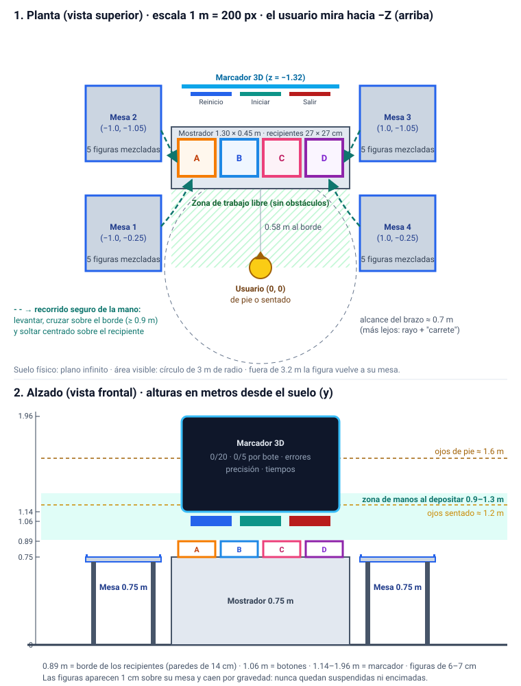

# 5. Diseño de la actividad, conceptos de física y evidencias (3.2 Interacción virtual)

Este documento sigue el orden de la guía de la práctica. Los detalles de implementación (motor, colisionadores, agarre, validación) están en [04-fisica-y-clasificacion.md](04-fisica-y-clasificacion.md).

---

## 1. Recuperar la práctica 3.1 y analizar su interacción

### 1.1 Punto de partida

La práctica 3.1 ([laboratorio-vr-ensamblaje](https://github.com/melissaManzano/laboratorio-vr-ensamblaje)) ofrecía:

- una sesión `immersive-vr` con fondo opaco;
- seguimiento de ambas manos con mallas de WebXR Input Profiles;
- un rayo desde el punto entre el pulgar y el índice;
- pinza con histéresis;
- arrastre de cinco piezas y validación al soltar con *snap*;
- un HUD 3D y botones 3D;
- la publicación en GitHub Pages.

### 1.2 Módulos reutilizados

| Módulo de la 3.1 | Función | En la 3.2 |
|---|---|---|
| [xr/xrSession.js](../js/xr/xrSession.js) | Detección de capacidades y ciclo de la sesión (cumple el papel de **VRButton**, con mensajes en español y errores traducidos) | Sin cambios |
| [xr/hands.js](../js/xr/hands.js) | Manos izquierda y derecha, rayo, pérdida de tracking | Sin cambios |
| [xr/pinchDetector.js](../js/xr/pinchDetector.js) | Pinza por articulaciones con histéresis y filtro del gesto del sistema | Sin cambios |
| [interaction/selectables.js](../js/interaction/selectables.js) | **Selección**: lista cerrada con prioridad botón > objeto | Se añade la búsqueda del más cercano (agarre con la mano) |
| [interaction/dragController.js](../js/interaction/dragController.js) | **Arrastre** a lo largo del rayo con offset | Ya no mueve la malla: calcula un **objetivo** para la física; se añade el "carrete" |
| [interaction/interactionManager.js](../js/interaction/interactionManager.js) | Une fuentes (manos o mouse), raycast, botones y juego | Pasa el cuerpo a cinemático y de vuelta a dinámico |
| ui/vrPanel.js | **HUD** 3D | Reemplazado por [ui/scoreboard.js](../js/ui/scoreboard.js), con la misma técnica (canvas → textura, redibujo por firma) |
| [ui/vrButtons.js](../js/ui/vrButtons.js) | Botones 3D con antirrebote | Se añade el botón *Comenzar* y la visibilidad por fase |
| [ui/landingUI.js](../js/ui/landingUI.js), `index.html`, favicon, `.nojekyll`, rutas relativas | Portada Bootstrap y **publicación** | Ampliados (clases, resumen y check de cannon-es) |
| audio, canvasText, bootGuard, debug | Soporte | Se reutilizan; se añaden sonidos de impacto y de recipiente lleno |

**Se retiró:** la validación al soltar con *snap* (`assemblyRules.js`). La práctica 3.2 prohíbe el *snap* y exige que la física decida.

### 1.3 Referencia: `webxr_vr_handinput_pointerdrag` de Three.js

Del ejemplo oficial se adoptó el **patrón de interacción**:

1. la mano proyecta un rayo;
2. la pinza "aprieta" sobre lo que el rayo toca;
3. mientras dura la pinza, el objeto se mueve con el rayo;
4. al abrir los dedos, se suelta.

El ejemplo usa sus propios modelos de puntero y organiza los objetos arrastrables y los botones como componentes. Este proyecto conserva su implementación de la 3.1 (rayo desde el punto de pinza, histéresis propia, filtro del gesto del sistema) y añade lo que el ejemplo no tiene: **cuerpos físicos**, paso a cinemático al sujetar y velocidad de liberación. No se copió código ni diseño del ejemplo.

### 1.4 Respaldo antes de modificar

- La 3.1 queda **intacta** en su propio repositorio. La 3.2 se desarrolla en un repositorio nuevo, [interaccion-vr-lab](https://github.com/melissaManzano/interaccion-vr-lab), que conserva todo el historial.
- El último commit de la 3.1 está marcado con la etiqueta **`practica-3.1`**. Para recuperarlo en cualquier momento: `git checkout practica-3.1`.

## 2. Categorías y reglas de clasificación

| Punto | Decisión |
|---|---|
| 2.1 Cuatro tipos de figura | **Cubo, esfera, cilindro y prisma triangular**: siluetas muy distintas entre sí y con colisionadores exactos o convexos en cannon-es |
| 2.2 Cinco por categoría | 5 × 4 = **20 figuras** (`cube-1` … `prism-5`), cada una con su propio cuerpo rígido |
| 2.3 Recipientes | **4 cajas abiertas** (27 × 27 × 14 cm), una por categoría. Cada una tiene borde del color de su clase, placa frontal "A · Cubos", silueta flotante de la figura y pantalla 0/5 |
| 2.4 Depósito correcto | Centro de la figura **dentro del volumen útil** del recipiente **y** estable 350 ms |
| 2.4 Intento erróneo | Misma condición en un recipiente de **otra** categoría: se registra **una vez** y el recipiente expulsa la figura |

## 3. Mesas, recipientes y distribución aleatoria



- **3.1 Mesas:** 4 mesas de 55 × 55 cm a 0.75 m, con un **borde de 2.5 cm** que evita que las esferas rueden fuera. Son cuerpos estáticos.
- **3.2 Distribución al azar ([layoutGenerator.js](../js/objects/layoutGenerator.js)):**
  - se barajan las 20 figuras y se reparten 5 por mesa, así las clases quedan mezcladas;
  - en cada mesa se eligen 5 de 6 ranuras separadas 15–17 cm (la figura más ancha mide 8.4 cm), con ±1.5 cm de variación y un giro aleatorio;
  - **sin superposiciones:** las pruebas recorren 25 semillas y verifican más de 9 cm entre centros;
  - **sin piezas suspendidas:** cada figura aparece 1 cm sobre la mesa y la gravedad la asienta (verificado: desviación 0.0 mm).
- **3.3 Recipientes:** sobre un mostrador frente al usuario, con el borde a 0.89 m y a 0.58 m del usuario. Se alcanzan de pie o sentado, sin caminar.
- **3.4 Esquema:** la imagen de arriba muestra en planta y alzado:
  - mesas, recipientes, marcador y botones;
  - alturas de 0.75, 0.89, 1.06 y 1.14–1.96 m;
  - altura de los ojos de pie y sentado;
  - la zona de trabajo libre;
  - los **recorridos seguros** de la mano: levantar la figura, cruzar sobre el borde (≥ 0.9 m) y soltarla centrada sobre el recipiente. El marcador y los botones quedan detrás de los recipientes, fuera de ese recorrido.

## 4. Herramientas y evidencias

| Punto | Estado |
|---|---|
| 4.1 Repositorio | [interaccion-vr-lab](https://github.com/melissaManzano/interaccion-vr-lab), vinculado a la 3.1 por historial, por la etiqueta `practica-3.1` y por un enlace en el README |
| 4.2 Live Server y HTTPS | En local funciona servido por HTTP (`127.0.0.1`), igual que con Live Server. La versión HTTPS de GitHub Pages en Meta Quest Browser **la debe comprobar la autora en el visor** |
| 4.3 Capturas | En [capturas/](capturas/), generadas en la vista previa de escritorio (ver la tabla siguiente). Las capturas **dentro del visor** se toman en el Quest |
| 4.4 Portada | Se conservan el favicon, la portada responsiva con Bootstrap, los créditos y las licencias; los enlaces son públicos |

| Captura | Muestra |
|---|---|
| [01-mesas-y-20-figuras.png](capturas/01-mesas-y-20-figuras.png) | 4 mesas, 20 figuras mezcladas, 4 recipientes, marcador en *Pendiente* y botón *Comenzar* |
| [09-portada.png](capturas/09-portada.png), [10-portada-movil.png](capturas/10-portada-movil.png) | Portada «3.2 Interacción virtual» en escritorio y móvil |
| [02-agarre-cinematico.png](capturas/02-agarre-cinematico.png) | Figura sujeta (resaltada en azul) empujada contra su mesa sin atravesarla |
| [03-acierto.png](capturas/03-acierto.png) | Acierto: destello verde, recipiente 1/5 |
| [04-error-y-expulsion.png](capturas/04-error-y-expulsion.png) | Error: borde rojo y esfera expulsada en el aire |
| [05-colisiones-caida.png](capturas/05-colisiones-caida.png) | Cuatro cilindros cayendo sobre una mesa con figuras |
| [06-colisiones-reposo-y-recuperable.png](capturas/06-colisiones-reposo-y-recuperable.png) | Las mismas figuras en reposo tras chocar; el marcador indica los estados transitorios |
| [07-vista-final.png](capturas/07-vista-final.png) | Las 20 figuras clasificadas dentro de sus recipientes |
| [08-marcador-final.png](capturas/08-marcador-final.png) | Marcador final: 20/20, tiempo global, tiempo de llenado de cada bote, errores y precisión |

> Algunos casos se escenificaron desde la consola (soltar figuras sobre un recipiente) para fotografiarlos. La caída, el choque, la validación y el marcador son siempre los reales.

## 5. Conceptos de física

### 5.1 Malla visual, cuerpo rígido y colisionador

| Concepto | Qué es | Dónde está |
|---|---|---|
| **Malla visual** | Lo que se **ve**: geometría + material de Three.js. No tiene masa ni choca | `THREE.Mesh` en [objectFactory.js](../js/objects/objectFactory.js) |
| **Cuerpo rígido** | Lo que se **mueve**: masa, posición, orientación, velocidad. No se deforma | `CANNON.Body` |
| **Colisionador** | La **forma** con la que el cuerpo choca. Puede ser más simple que la malla | `CANNON.Box`, `Sphere`, `Cylinder` en [colliders.js](../js/physics/colliders.js) |

En este proyecto, la malla y el colisionador de cada figura se crean **en el mismo lugar y con las mismas medidas**, para que lo que se ve coincida con lo que choca. La malla **solo copia** la pose del cuerpo; nunca al revés.

### 5.2 Conceptos utilizados

| Concepto | Significado | Valor en el proyecto |
|---|---|---|
| Gravedad | Aceleración constante hacia abajo | −9.82 m/s² en Y |
| Masa | Resistencia a cambiar de velocidad; reparte los empujes al chocar | 100–120 g por figura |
| Cuerpo **dinámico** | Lo mueven las fuerzas, la gravedad y los choques | Figuras sueltas |
| Cuerpo **estático** | No se mueve nunca; masa infinita | Suelo, mesas, mostrador, recipientes |
| Cuerpo **cinemático** | Se mueve solo por la velocidad que se le asigna; empuja a los dinámicos y no le afectan fuerzas ni choques | Figura **sujeta** por la mano |
| Fricción | Resistencia al deslizar entre dos superficies (0 = hielo) | 0.40–0.60 según el par de materiales |
| Restitución | Fracción de la velocidad que se conserva al rebotar (0 = no rebota) | 0.15 (recipiente) a 0.35 (suelo) |
| Amortiguamiento | Pérdida de velocidad por segundo (aire, rodadura) | 0.05; esferas 0.4 lineal y 0.6 angular |
| Detección de contacto | **Broadphase** (pares que podrían tocarse, SAP) → **narrowphase** (puntos y normales de contacto) → **solver** (impulsos que separan, aplican fricción y rebote) | `SAPBroadphase`, 12 iteraciones del solver |
| Sueño | Los cuerpos quietos dejan de simularse hasta que algo los toca | A 0.05 m/s durante 0.6 s |

### 5.3 Paso fijo y sincronización con Three.js

La pantalla del Quest dibuja a 72–120 Hz y el tiempo entre cuadros varía. Si la física avanzara un `dt` variable, la simulación cambiaría con los FPS (rebotes distintos, objetos que atraviesan paredes en un cuadro lento). Por eso se usa un **paso fijo**:

```js
// physicsWorld.js — cannon-es acumula el tiempo real y ejecuta pasos de exactamente 1/90 s
// (el Anexo sugiere ~1/60 s; se justifica 1/90 s en docs/04, sección 2)
world.step(1 / 90, deltaSeconds, 4);   // máximo 4 subpasos por cuadro

// objectFactory.js — cada cuadro, la malla copia la pose INTERPOLADA del cuerpo
mesh.position.copy(body.interpolatedPosition);
mesh.quaternion.copy(body.interpolatedQuaternion);
```

- Si en un cuadro pasan 25 ms, se ejecutan 2 pasos de 11.1 ms y sobran 2.8 ms para el siguiente cuadro.
- La **interpolación** dibuja la pose entre los dos últimos pasos según el tiempo sobrante, así el movimiento se ve suave aunque los FPS no coincidan con los 90 Hz.
- El agarre se reaplica antes de **cada** subpaso (evento `postStep`), no solo una vez por cuadro.

### 5.4 Colisiones comprobadas

Verificado en la vista previa (ver [04, sección 10](04-fisica-y-clasificacion.md#10-verificación-realizada)):

- figura–mesa: se asientan sin hundirse;
- figura–figura: cilindros cayendo sobre otras figuras;
- figura–pared del recipiente: una figura soltada sobre el borde se vuelca hacia fuera; la expulsión choca con las paredes;
- figura–suelo: rebote, rodadura y reposo;
- figura sujeta–mesa: el barrido impide atravesarla.

## 11. Pruebas en computadora frente a pruebas en el visor

| Prueba | Escritorio (Live Server / vista previa) | Requiere Meta Quest 3 |
|---|---|---|
| Portada Bootstrap, favicon, créditos y diseño responsivo | ✅ | — |
| Console y Network sin errores (import map, CDN, módulos, cannon-es) | ✅ | Repetir con la URL HTTPS (depuración remota) |
| 20 figuras en 4 mesas; gravedad, rebote y colisiones sin interpenetrar | ✅ | Confirmar a escala real |
| Agarre → cinemático → soltar → dinámico | ✅ con el mouse | ✅ con las **manos** |
| Acierto, error, expulsión, precisión, tiempos de llenado, 20/20, reinicio | ✅ | Confirmar |
| Botones 3D *Comenzar*, *Reinicio aleatorio* | ✅ con el mouse | ✅ con la pinza |
| Sesión `immersive-vr`, *Salir de VR*, salida por el menú del sistema | ❌ (el navegador de escritorio no tiene visor) | ✅ |
| Seguimiento de ambas manos, pinza, gesto del sistema, pérdida de tracking | ❌ | ✅ |
| Agarre cercano y "carrete" con el brazo | ❌ (el mouse usa la rueda en su lugar) | ✅ |
| Rendimiento (FPS) y comodidad | ❌ (no es representativo) | ✅ (OVR Metrics Tool) |
